<div align="center">

# 🌐 Dropweave

### Fast, anonymous, zero-knowledge, peer-to-peer file transfer over WebRTC.

One command to send. One 8-character code to receive.  
No cloud storage. No user accounts. No logs. No traces.

[](https://github.com/iamharshil/dropweave/actions/workflows/ci.yml)
[](https://www.npmjs.com/package/dropweave)
[](https://www.npmjs.com/package/dropweave)
[](https://github.com/iamharshil/dropweave)
[](https://github.com/iamharshil/dropweave)
[](LICENSE)
[](https://www.typescriptlang.org/)
[](https://bun.sh/)
[](https://webrtc.org/)
[](CONTRIBUTING.md)

[Quick Start](#-quick-start-installation--usage) •
[Features](#-features) •
[Architecture](#-architecture--protocol) •
[CLI Reference](#-cli-reference) •
[TypeScript API](#-typescript-api) •
[Signaling Server](#-self-hosting-signaling) •
[Security Model](#-security--privacy-model)

</div>

---

## ⚡ Quick Start: Installation & Usage

Send and receive files directly in under 30 seconds across macOS, Windows, and Linux.

### 🚀 1. Instant Transfer (Zero Install Needed!)

If you have [Node.js](https://nodejs.org/) installed, you **don't need to install anything at all**. Run Dropweave directly using `npx`:

#### 📤 On the Sender Computer:
```bash
npx dropweave send "path/to/your-file.zip"
```

Dropweave generates an ephemeral 8-character connection code with live radar beacon animation:
```text
  Sending: ./presentation.zip (18.4 MB)

  ┌──────────────────────────────────────────────┐
  │  Code: 7KMP-4Q9D                             │
  │  Expires in: 10:00                           │
  └──────────────────────────────────────────────┘

  ⠋ Waiting for peer...  📡 · · ● · · · · 📥  (09:59)
```

Share that code (`7KMP-4Q9D`) with the receiver via chat, Slack, WhatsApp, email, or voice.

#### 📥 On the Receiver Computer:
```bash
npx dropweave receive 7KMP-4Q9D
```

```text
  Joining session: 7KMP-4Q9D
  ⠋ Connecting to peer...
  ✓ Peer connected (direct) ⚡
  📤 ────📦─────► 📥  █████████░░░░░░░░░  50%  18.4 MB/s  00:01 remaining

  ✓ Complete: presentation.zip (18.4 MB in 1.1s) [verified]
  Saved to: /Users/alice/Downloads/presentation.zip
```

File bytes travel directly device-to-device with real-time speed progress and cryptographic SHA-256 verification.

---

### 📦 2. Install Permanently as a CLI Tool (Recommended for Everyday Use)

If you use Dropweave frequently and want to type `dropweave` directly without `npx`:

```bash
# Using npm (recommended for modern npm / Node.js 20+):
npm install -g --allow-scripts=node-datachannel dropweave

# Or standard npm install:
npm install -g dropweave

# Or using bun
bun add -g dropweave
```

Now you can simply run:
```bash
# Send any file
dropweave send ./my-video.mp4

# Receive using the 8-character code
dropweave receive 7KMP-4Q9D
```

---

### 💻 3. Use as a TypeScript / Node.js Library (For Developers)

Add Dropweave directly into your own Node.js or TypeScript projects:

```bash
npm install dropweave
# or
bun add dropweave
```

```typescript
import { createTransfer } from 'dropweave';

// Sender: create session and stream directly
const transfer = createTransfer();
const session = await transfer.openSession();
console.log(`Share code with peer: ${session.code}`);

await session.waitForPeer();
await transfer.send('./data.zip');
await transfer.close();
```

---

### ❓ What do I need first? (Prerequisites)

The only prerequisite is **Node.js** (version 18 or newer), which takes 1 minute to set up:

1. Visit [nodejs.org](https://nodejs.org/).
2. Download the recommended **LTS (Long Term Support)** version.
3. Open the installer and follow the prompt (*Next*, *Finish*).
4. Open your terminal (Terminal on Mac/Linux, PowerShell or Command Prompt on Windows) and run `npx dropweave --help`!

---

## ⚡ What is Dropweave?

**Dropweave** is a modern, high-performance CLI tool and TypeScript library designed for **direct peer-to-peer file transfers** between machines anywhere on the internet.

Instead of uploading files to a third-party server (like Google Drive, Dropbox, or WeTransfer) and downloading them later, Dropweave streams file bytes **directly from the sender to the receiver** using encrypted **WebRTC data channels**.

A lightweight WebSocket signaling service coordinates initial connection discovery using ephemeral **8-character connection codes** (`7KMP-4Q9D`), without ever seeing, proxying, or storing your file data.

```text
Host (Sender)                                       Peer (Receiver)
┌─────────────────────────────────┐                 ┌─────────────────────────────────┐
│ $ dropweave send ./video.mp4    │                 │ $ dropweave receive 7KMP-4Q9D   │
│                                 │                 │                                 │
│ ┌─────────────────────────────┐ │                 │ ┌─────────────────────────────┐ │
│ │  Code: 7KMP-4Q9D            │ │  8-Char Code    │ │  Joining: 7KMP-4Q9D         │ │
│ │  Expires: 10:00             ├─┼────────────────►│ │  Session approved.          │ │
│ └─────────────────────────────┘ │                 │ └─────────────────────────────┘ │
│                                 │                 │                                 │
│ ✓ Peer connected (direct)       │                 │ ✓ Peer connected (direct)       │
│ ████████████████░░░░  82%       │ Direct WebRTC   │ ████████████████░░░░  82%       │
│ 18.4 MB/s  00:03 remaining      ├────────────────►│ 18.4 MB/s  00:03 remaining      │
└─────────────────────────────────┘                 └─────────────────────────────────┘
```

---

## ✨ Features

- 🌍 **100% OS Agnostic**: Seamlessly transfer files between **macOS**, **Windows**, and **Linux** without device barriers or ecosystem lock-in.
- 🔒 **Direct Encrypted Transport**: Encrypted with WebRTC DTLS / SCTP data channels. File bytes travel directly between peers.
- 👁️ **Zero-Knowledge Signaling**: The signaling server only pairs peers using in-memory random codes. It **never touches file chunks**, stores no logs, and does not record IP addresses.
- 🔑 **8-Character Pairing Codes**: Crockford Base32 alphabet avoids ambiguous characters (`0/O`, `1/I/L`). Auto-normalizes dashes, spaces, and lowercase input.
- ⚡ **Adaptive Chunk Sizing (16 KiB – 256 KiB)**: Continuously monitors rolling RTT and throughput to dynamically adjust chunk sizes for maximum throughput on your specific network.
- 🌊 **Backpressure Flow Control**: High/low watermark buffer thresholds prevent memory bloat, allowing you to transfer files of arbitrary size with bounded RAM usage (< 50 MB RSS).
- 🛡️ **Streaming SHA-256 Integrity Verification**: Hashes data on-the-fly while reading and writing. Transfers complete only after the receiver confirms a byte-for-byte cryptographic checksum match.
- 🗄️ **Defensive Path Safety & Atomic Writes**: Protects against path traversal attacks. Incomplete transfers are written to temporary `.dwpart` files and atomically renamed only when verified.
- 🤖 **Unix-Friendly & Scriptable**: Includes `--quiet` flag with JSON output for integration into CI/CD and automation scripts.

---

## 🎯 When to Use Dropweave (Common Scenarios)

- 🚀 **Transferring Huge Files (GBs) Fast**: Skip uploading for 30 minutes to Google Drive or WeTransfer just for the recipient to spend another 30 minutes downloading. Stream file bytes directly at maximum network throughput.
- 🍏 🪟 🐧 **Cross-Platform File Sharing (AirDrop Alternative)**: AirDrop only works between Apple devices. Dropweave gives you seamless peer-to-peer file transfer between **macOS, Windows, and Linux** with a simple 8-character code.
- 🔒 **Confidential & Sensitive Data**: Transfer private database backups, SSH keys, financial reports, or code repositories without trusting third-party cloud storage providers. Zero-knowledge signaling ensures your files never touch any intermediary server.
- 🤖 **DevOps & Server-to-Server Transfers**: Send build artifacts, Docker images, or archives directly between servers, staging environments, or developer laptops from the terminal.
- 🏠 **Local Network Offline Transfers**: Use the `--no-stun` flag to transfer files purely over your local home/office Wi-Fi or LAN without any external traffic.

---

## 📊 Comparison

| Feature | Dropweave | Magic-Wormhole | WeTransfer / GDrive | AirDrop |
| :--- | :---: | :---: | :---: | :---: |
| **Direct P2P Transfer** | ✅ Yes (WebRTC) | ✅ Yes (TCP) | ❌ Cloud Upload | ✅ Local Wi-Fi/BT |
| **OS Agnostic (Mac, Win, Linux)** | ✅ All Platforms | ✅ All Platforms | ✅ Web Browser | ❌ Apple Only |
| **Cross-Network (NAT/Firewall)** | ✅ STUN / TURN | ⚠️ Relay Server | ✅ Yes | ❌ Local LAN Only |
| **Zero-Knowledge Architecture** | ✅ Ephemeral RAM | ✅ PAKE | ❌ Cloud Inspects | ⚠️ Apple ID Linked |
| **No Account / Signup Needed** | ✅ Zero Auth | ✅ Zero Auth | ❌ Required | ⚠️ Apple Ecosystem |
| **Adaptive Chunk Flow Control** | ✅ 16–256 KiB dynamic | ❌ Fixed | N/A | ❌ Proprietary |
| **Binary Wire Protocol** | ✅ 12-byte header | ❌ JSON Envelope | ❌ HTTP Multipart | ❌ Proprietary |
| **Node.js & Scriptable CLI** | ✅ Full CLI + SDK | ⚠️ Python / Go CLI | ❌ Web / API key | ❌ Apple Only |

---

## 💻 OS Agnostic — Works Everywhere

Dropweave is completely **cross-platform and operating-system agnostic**. You can send and receive files across different operating systems without compatibility issues:

| Sender Device | ➡️ | Receiver Device | Compatibility |
| :---: | :---: | :---: | :---: |
| 🍏 **macOS** | ➡️ | 🪟 **Windows** | ✅ Supported |
| 🪟 **Windows** | ➡️ | 🐧 **Linux** | ✅ Supported |
| 🐧 **Linux** | ➡️ | 🍏 **macOS** | ✅ Supported |
| 🍏 **macOS** | ➡️ | 🍏 **macOS** | ✅ Supported |
| 🪟 **Windows** | ➡️ | 🪟 **Windows** | ✅ Supported |

- **macOS**: Apple Silicon (M1/M2/M3/M4) & Intel
- **Windows**: Windows 10/11 (PowerShell, Command Prompt, Windows Terminal)
- **Linux**: Ubuntu, Debian, Fedora, Arch, Alpine, etc.

---

## ⚙️ CLI Reference

### `dropweave send <file>`

Host a temporary transfer session and wait for a peer to join.

```text
Usage: dropweave send [options] <file>

Arguments:
  file                     Path to the file to send

Options:
  -s, --signal <url>       Signaling server URL (default: "ws://localhost:8080/ws" or DROPWEAVE_SIGNALING_URL)
  -t, --timeout <seconds>  Session timeout in seconds (default: "600")
  --no-stun                Disable public STUN servers (for local/LAN transfers)
  -q, --quiet              Quiet mode — output JSON only (default: false)
  -h, --help               Display help for command
```

#### Examples:
```bash
# Send with custom 5-minute timeout
dropweave send ./archive.tar.gz -t 300

# Connect to a hosted signaling server
dropweave send ./data.sqlite -s wss://signal.mydomain.com/ws

# Local LAN transfer (skip public STUN)
dropweave send ./photo.jpg --no-stun

# Quiet JSON mode for automation
dropweave send ./build.zip --quiet
```

### `dropweave receive <code>`

Join an active session and download the incoming file.

```text
Usage: dropweave receive [options] <code>

Arguments:
  code                The 8-character connection code (hyphens & case-insensitive)

Options:
  -s, --signal <url>  Signaling server URL (default: "ws://localhost:8080/ws" or DROPWEAVE_SIGNALING_URL)
  -o, --output <dir>  Directory to save received file (default: ".")
  --no-stun           Disable public STUN servers (for local/LAN transfers)
  -q, --quiet         Quiet mode — output JSON only (default: false)
  -h, --help          Display help for command
```

#### Examples:
```bash
# Receive into ~/Downloads
dropweave receive 7KMP-4Q9D -o ~/Downloads

# Receive without hyphens (case-insensitive)
dropweave receive 7kmp4q9d

# Automation output
dropweave receive 7KMP4Q9D --quiet
```

---

## 🏗️ Architecture & Protocol

### 1. Connection Negotiation Flow

```mermaid
sequenceDiagram
    autonumber
    actor Sender as Sender CLI
    participant Sig as Signaling Server
    actor Receiver as Receiver CLI

    Sender->>Sig: session:create
    Sig-->>Sender: session:created (Code: 7KMP-4Q9D)
    Note over Sender: Displays 8-character code

    Receiver->>Sig: session:join (Code: 7KMP-4Q9D)
    Sig->>Sender: session:join-requested
    Sender->>Sig: session:approve
    Sig-->>Receiver: session:approved

    rect rgb(30, 41, 59)
    Note over Sender,Receiver: WebRTC ICE & SDP Signaling
    Sender->>Sig: peer:offer (SDP)
    Sig->>Receiver: peer:offer (SDP)
    Receiver->>Sig: peer:answer (SDP)
    Sig->>Sender: peer:answer (SDP)
    Sender-)Sig: peer:ice-candidate
    Sig-)Receiver: peer:ice-candidate
    Receiver-)Sig: peer:ice-candidate
    Sig-)Sender: peer:ice-candidate
    end

    Note over Sender,Receiver: Direct WebRTC DataChannel Opens (Signaling closes)
    Sender-->>Receiver: [Binary Packet Stream] (DataChunk, Checksum)
    Receiver-->>Sender: [Verification Ack] (ChecksumVerify)
```



### 2. Binary Wire Protocol

Data channel packets use a high-efficiency 12-byte binary header:

```
┌─────────────┬───────────┬────────────┬──────────────┬──────────────────┬─────────────────┐
│ Magic (2B)  │ Type (1B) │ Flags (1B) │ Sequence(4B) │ Payload Len (4B) │  Payload (var)  │
│    0x4457   │  0x01..FF │  Bitfield  │ uint32 (BE)  │   uint32 (BE)    │ Raw binary data │
└─────────────┴───────────┴────────────┴──────────────┴──────────────────┴─────────────────┘
```

- **Magic (`0x4457` - "DW")**: Fast frame verification.
- **Message Types**:
  - `0x01` `TransferOffer`: File metadata (name, size, MIME, chunk size).
  - `0x02` `TransferAccept`: Receiver acceptance.
  - `0x03` `TransferReject`: User refusal.
  - `0x10` `DataChunk`: Raw binary file segment.
  - `0x11` `ChunkAck`: Sequence acknowledgement.
  - `0x20` `Checksum`: 32-byte SHA-256 hash digest.
  - `0x21` `ChecksumVerify`: Verification status (`0x01` match, `0x00` fail).
  - `0xF0` `Cancel`: Graceful transfer cancellation.
  - `0xFF` `Ping/Pong`: RTT probing with high-resolution timestamps.

---

## 🧩 TypeScript API

Dropweave can be integrated directly into Node.js applications:

```typescript
import {
  SignalingClient,
  PeerConnectionWrapper,
  sendFile,
  receiveFile,
} from 'dropweave';

// 1. Sender Example:
const signaling = new SignalingClient({ url: 'wss://signal.example.com/ws' });
await signaling.connect();

signaling.send('session:create');
const { sessionCode } = await signaling.waitFor('session:created');
console.log(`Share code with peer: ${sessionCode}`);

await signaling.waitFor('session:join-requested');
signaling.send('session:approve', undefined, sessionCode);

const peer = new PeerConnectionWrapper();
// (wire signaling messages between signaling and peer)

const dataChannel = peer.createDataChannel('transfer');
// once dataChannel opens:
const result = await sendFile({
  filePath: '/path/to/large-video.mp4',
  dataChannel,
  onProgress: (p) => {
    console.log(`${p.percentage}% @ ${(p.speed / 1e6).toFixed(2)} MB/s`);
  },
});

console.log(`Transfer complete! Verified: ${result.verified}`);
```

---

## 🖥️ Self-Hosting Signaling

The Dropweave signaling server is a **zero-dependency** Bun service. It stores nothing on disk and holds only ephemeral in-memory state.

### Running with Bun

```bash
git clone https://github.com/iamharshil/dropweave.git
cd dropweave

# Start server
PORT=8080 bun run dev:signal
```

### Docker

```dockerfile
FROM oven/bun:latest
WORKDIR /app
COPY . .
RUN bun install --production
EXPOSE 8080
CMD ["bun", "run", "apps/signaling-server/src/index.ts"]
```

```bash
docker build -t dropweave-signal .
docker run -d -p 8080:8080 --name signal dropweave-signal
```

### Health Check

```bash
curl http://localhost:8080/health
# {"status":"ok","activeSessions":0}
```

---

## 🛡️ Security & Privacy Model

Dropweave follows a strict privacy-by-design architecture:

1. **Zero Knowledge**: The signaling server only handles connection metadata (SDP offers, answers, and ICE candidates). It **never sees file content, file names, or file sizes**.
2. **Ephemeral Memory**: All session state is stored in server RAM and automatically evicted when the session closes, the peer disconnects, or after 10 minutes.
3. **No IP Logging**: The signaling service associates rate limiting with opaque WebSocket connection IDs rather than storing IP addresses.
4. **Path Traversal Protection**: Remote file names are sanitized to prevent directory traversal (`../../etc/passwd` becomes `passwd`).
5. **Atomic Writing**: Chunks stream into `.dwpart` files. Only after cryptographic SHA-256 confirmation is the file renamed to its final target. Cancelled or failed transfers are immediately deleted.
6. **CSPRNG 8-Character Codes**: Generated using `crypto.randomBytes` (40 bits of entropy) with Crockford Base32 characters, preventing brute-force enumeration via per-connection rate limits.

---

## 🧪 Development & Testing

```bash
# Clone
git clone https://github.com/iamharshil/dropweave.git
cd dropweave

# Install dependencies
bun install

# Run entire test suite (124 tests: unit, integration, fuzzing, e2e)
bun test

# Run TypeScript type check
bun run typecheck

# Build release bundles
bun run build
```

---

## 📄 License

GNU General Public License v3.0 (GPL-3.0) © [Harshil](https://github.com/iamharshil)

This program is free software: you can redistribute it and/or modify it under the terms of the **GNU General Public License v3.0** as published by the Free Software Foundation. See the [LICENSE](LICENSE) file for the full license text.
